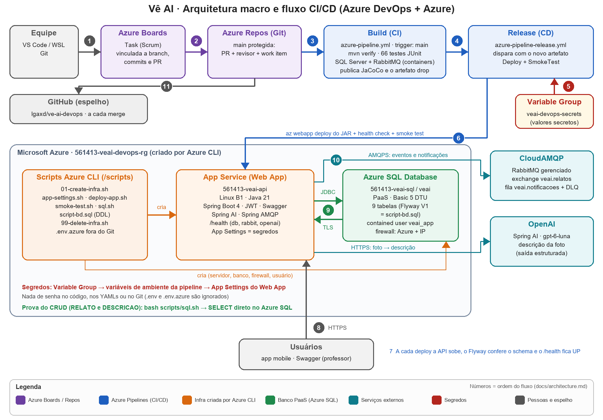

# Vê AI · DevOps Tools & Cloud Computing

Global Solution 2026/2 · FIAP 2TDSPX · tema CitizenTech

A API Java do **Vê AI** entregue por **Azure DevOps** (Boards, Repos e Pipelines) num **Azure App Service**, com banco **Azure SQL** (PaaS) e infraestrutura criada só com **Azure CLI**. Cada merge na `main` é compilado, testado, empacotado e implantado na nuvem sem nenhum passo manual.

| Link | |
|---|---|
| Projeto no Azure DevOps | `https://dev.azure.com/RM561469/VeAI-DevOps` |
| API na nuvem (Swagger) | `https://561413-veai-api.azurewebsites.net/swagger-ui.html` |
| Espelho no GitHub | `https://github.com/lgaxd/ve-ai-devops` |
| Vídeo no YouTube | `___` |

| Integrante | RM | Turma |
|---|---:|---|
| Lucas Grillo Alcântara | 561413 | 2TDSPX |
| Pietro Ferreira Gomes Abrahamian | 561469 | 2TDSPX |
| Pedro Peres Benitez | 561792 | 2TDSPX |
| Lucca Ramos Mussumecci | 562027 | 2TDSPX |

---

## 1. A solução

O **Vê AI** é um assistente em português para pessoas cegas ou com baixa visão. Enquanto a pessoa anda, o app fotografa o caminho a cada poucos segundos e a IA narra o que muda, **falando os perigos primeiro**. Quando a IA reconhece uma barreira permanente (buraco, calçada obstruída, falta de piso tátil, semáforo sem som), o app pergunta se a pessoa quer avisar a rede de apoio. O relato chega com GPS ao gestor da região (ONG/CRAS), que faz a triagem e o encaminha à prefeitura; o cidadão recebe notificações a cada mudança.

Esta entrega implanta a **API REST** (a mesma da disciplina de Java Advanced) que o app mobile consome:

| Camada | Tecnologia |
|---|---|
| Aplicação | Java 21, Spring Boot 4, Spring Security (JWT), Spring Data JPA, Flyway, springdoc (Swagger) |
| IA | Spring AI + OpenAI (descrição estruturada da foto) |
| Mensageria | Spring AMQP + CloudAMQP (RabbitMQ gerenciado): notificações assíncronas |
| Banco | **Azure SQL Database** (PaaS), Basic 5 DTU, 9 tabelas |
| Hospedagem | **Azure App Service** Linux B1 (Java 21), deploy do JAR |
| Infraestrutura | **Azure CLI** (`/scripts`) |
| CI/CD | Azure Boards, Azure Repos, Azure Pipelines (YAML), Variable Group |
| Testes | JUnit 5, MockMvc, Testcontainers (SQL Server 2022 + RabbitMQ), JaCoCo |

## 2. Arquitetura macro



O fluxo numerado (1 a 11), os componentes e as decisões estão em [docs/architecture.md](docs/architecture.md).

## 3. Infraestrutura na Azure (Azure CLI)

Criada por [scripts/01-create-infra.sh](scripts/01-create-infra.sh), num Resource Group próprio:

| Recurso | Nome | Configuração |
|---|---|---|
| Resource Group | `561413-veai-devops-rg` | região `chilecentral` (reserva `southafricanorth`) |
| Azure SQL (servidor lógico) | `561413-veai-sql` | TLS 1.2, firewall: serviços do Azure + IP de quem roda os SELECTs |
| Azure SQL (banco) | `veai` | Basic, 5 DTU, 2 GB, backup local |
| Usuário do banco da API | `veai_app` | contained user, `db_owner` só no banco `veai` (a API não usa o administrador) |
| App Service Plan | `561413-veai-plan` | Linux B1 |
| Web App | `561413-veai-api` | Java 21, HTTPS obrigatório, Always On, App Settings com os segredos |

```bash
cp .env.azure.example .env.azure   # preencha (arquivo fora do Git)
az login
bash scripts/01-create-infra.sh    # cria tudo (pode rodar de novo: só cria o que falta)
bash scripts/99-delete-infra.sh    # apaga o Resource Group depois da avaliação
```

O **schema** é o [scripts/script-bd.sql](scripts/script-bd.sql): o DDL das 9 tabelas, índices e constraints. O mesmo arquivo é a migração V1 do Flyway (`src/main/resources/db/migration/sqlserver/V1__schema.sql`), aplicada no primeiro start da API; a pipeline de Build confere que os dois são idênticos.

Passo a passo completo (projeto, políticas, Variable Group, service connection, pipelines): [docs/azure-devops.md](docs/azure-devops.md).

## 4. Azure DevOps

| Item | Configuração |
|---|---|
| Projeto | `VeAI-DevOps`, privado, Git, processo Scrum |
| Professor | Basic na organização, **Project Administrators** no projeto |
| Boards | Task vinculada a branch, commits (`AB#<id>`) e Pull Request |
| Repos | `main` protegida: revisor obrigatório (pode aprovar o próprio PR), work item vinculado, revisor padrão RM561413; sem push direto |
| Variable Group | `veai-devops-secrets`, com os segredos marcados como secretos |
| Service connection | `sc-veai-devops` (Azure Resource Manager, workload identity) |

## 5. Pipelines (YAML)

| Pipeline | Arquivo | Gatilho | O que faz |
|---|---|---|---|
| **`veai-build`** (CI) | [azure-pipeline.yml](azure-pipeline.yml) | commit na `main` (só via merge de PR) | Java 21 + cache Maven → confere `script-bd.sql` = V1 → `mvn clean verify` (**66 testes JUnit**, unitários e de integração com SQL Server 2022 e RabbitMQ em container) → publica os testes, a cobertura JaCoCo e o artefato **drop** (`ve-ai-api.jar` + scripts) |
| **`veai-release`** (CD) | [azure-pipeline-release.yml](azure-pipeline-release.yml) | novo artefato do `veai-build` na `main` | **Deploy:** grava os App Settings (segredos do Variable Group), `az webapp deploy` do JAR, espera o `/health` UP. **SmokeTest:** health, 401 sem token, login, componentes `db`/`rabbit`/`openai` UP e leituras na URL pública |
| `veai-mirror-github` | [azure-pipeline-mirror.yml](azure-pipeline-mirror.yml) | commit na `main` | espelha o commit no GitHub |

Requisitos atendidos:

1. Build dispara automaticamente a cada commit na `main`, que só recebe merge por PR.
2. Build publica o pacote (`ve-ai-api.jar`) e os resultados dos testes (JUnit) e da cobertura.
3. Release dispara automaticamente quando o Build gera um artefato novo (`resources.pipelines.trigger`).
4. Deploy em **Serviço de Aplicativo** (App Service) e banco em **Serviço PaaS** (Azure SQL).
5. Variáveis de ambiente nas pipelines (Variable Group → `env:` → App Settings). Nenhuma senha no código, nos YAMLs ou no Git.
6. Testes automáticos no CI, com banco e broker reais em container.

## 6. CRUD na nuvem (prova com SELECT)

O CRUD é demonstrado em duas tabelas que têm as quatro operações pela API, cada uma conferida com **SELECT direto no Azure SQL** ([scripts/sql.sh](scripts/sql.sh) + `sqlcmd`):

| Tabela | Create | Read | Update | Delete |
|---|---|---|---|---|
| `RELATO` | `POST /relatos` | `GET /relatos/{id}` | `PUT /relatos/{id}` | `DELETE /relatos/{id}` |
| `DESCRICAO` | `POST /descricoes` (foto) | `GET /descricoes/{id}` | `PATCH /descricoes/{id}/avaliacao` | `DELETE /descricoes/{id}` |

```bash
bash scripts/sql.sh -f database/crud-verification.sql                       # visão geral das tabelas
bash scripts/sql.sh "SELECT id, tipo, gravidade, status, texto FROM relato WHERE id = 16"
```

A API tem Swagger (`/swagger-ui.html`), com o JSON de cada requisição. Também há uma coleção Postman em [postman/](postman), com o ambiente `ve-ai-nuvem` já apontando para o Web App.

**Usuários de demonstração** (senha `Veai@2026`): cidadãos `ana.souza@veai.dev`, `bruno.lima@veai.dev`, `carla.mendes@veai.dev`, `diego.rocha@veai.dev`; gestores `marina.alves@ong-veai.dev` (Pinheiros e Sé) e `rafael.costa@cras-veai.dev` (Vila Mariana).

### Principais endpoints

| Método e rota | Papel | O que faz |
|---|---|---|
| `POST /auth/login` · `POST /auth/registrar` | público | JWT (8 h) e cadastro de cidadão |
| `POST /descricoes` | CIDADAO | foto (multipart) → descrição por IA, perigos primeiro, sugestão de relato |
| `GET/PATCH/DELETE /descricoes/{id}` | CIDADAO | histórico, avaliação e exclusão |
| `POST /relatos` | CIDADAO | cria o relato ou soma +1 apoio (regra dos 30 m), com `Idempotency-Key` |
| `GET/PUT/DELETE /relatos/{id}` · `GET /relatos/meus` | CIDADAO | acompanhar, editar e excluir |
| `GET /gestor/relatos` · `PATCH /gestor/relatos/{id}/status` | GESTOR | fila por prioridade e máquina de estados |
| `GET /notificacoes` · `PATCH /notificacoes/{id}/lida` | logado | notificações geradas pelo consumidor RabbitMQ |
| `GET /health` | público | status (com token: `db`, `rabbit` e `openai`) |

## 7. Estrutura do repositório

```text
azure-pipeline.yml           Build (CI)
azure-pipeline-release.yml   Release (CD)
azure-pipeline-mirror.yml    espelho no GitHub
scripts/                     Azure CLI (01-create-infra, app-settings, deploy-app, smoke-test, sql, 99-delete-infra) + script-bd.sql
dockerfiles/Dockerfile       imagem da API (usada só no docker-compose local)
docker-compose.yml           ambiente local opcional: API + SQL Server 2022 + RabbitMQ
database/                    crud-verification.sql (SELECTs do CRUD)
docs/                        architecture.md, azure-devops.md, roteiro-video.md, img/, openapi.yaml
postman/                     coleção e ambientes (local e nuvem)
src/                         código da API e testes
.env.azure.example           variáveis da infraestrutura (o .env.azure real não vai para o Git)
.env.example                 variáveis da API para rodar local
```

## 8. Rodar localmente (opcional)

A entrega roda na nuvem; localmente é só para desenvolver.

```bash
./mvnw clean verify               # compila e roda os 66 testes (precisa de Docker para o Testcontainers)
docker compose up -d --build      # API + SQL Server 2022 + RabbitMQ em http://localhost:8080/swagger-ui.html
```

Sem chave da OpenAI, a API usa o descritor falso (respostas fixas, sem custo). Para a IA real: `cp .env.example .env` e preencha `VEAI_IA_PROVEDOR=openai` e `OPENAI_API_KEY`.

## 9. Roteiro do vídeo

[docs/roteiro-video.md](docs/roteiro-video.md): README e arquitetura → recursos no Portal → Task no Boards → branch e alteração no código → PR e merge → Build e Release automáticos → artefatos e testes → alteração publicada → CRUD de `RELATO` e `DESCRICAO` com SELECT → Task concluída com os links.
