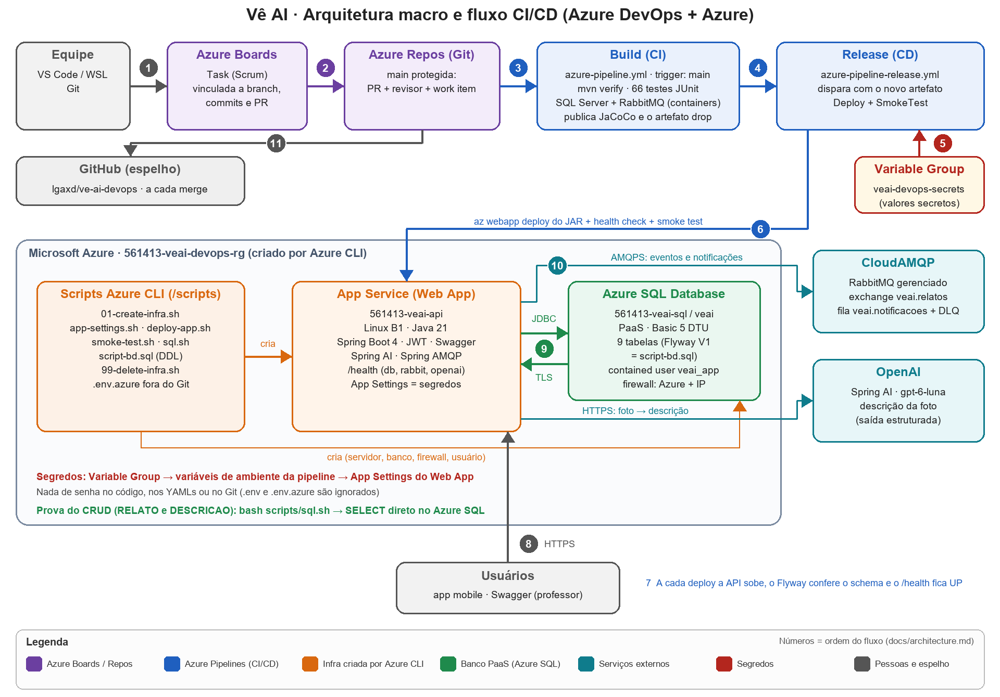

# Arquitetura macro e fluxo CI/CD

O diagrama é gerado por [gerar_diagrama.py](gerar_diagrama.py) (`python docs/gerar_diagrama.py`, requer Pillow).

## Componentes

| Componente | O que é | Onde está definido |
|---|---|---|
| Azure Boards | Tasks (processo Scrum) vinculadas a branches, commits e Pull Requests | projeto `VeAI-DevOps` |
| Azure Repos | repositório Git; `main` protegida (PR, revisor obrigatório, work item vinculado, revisor padrão) | [azure-devops.md](azure-devops.md) |
| Pipeline de Build (CI) | `veai-build`: compila, roda os testes e publica o JAR | [azure-pipeline.yml](../azure-pipeline.yml) |
| Pipeline de Release (CD) | `veai-release`: implanta o JAR do CI e faz o smoke test | [azure-pipeline-release.yml](../azure-pipeline-release.yml) |
| Espelho no GitHub | `veai-mirror-github`: copia a `main` para `lgaxd/ve-ai-devops` | [azure-pipeline-mirror.yml](../azure-pipeline-mirror.yml) |
| Variable Group | `veai-devops-secrets`: segredos (valores marcados como secretos) | Pipelines → Library |
| App Service | Web App Linux B1, Java 21 (`561413-veai-api`) executando o JAR do Spring Boot | [01-create-infra.sh](../scripts/01-create-infra.sh) |
| Azure SQL Database | servidor `561413-veai-sql`, banco `veai`, Basic 5 DTU (PaaS) | [01-create-infra.sh](../scripts/01-create-infra.sh), [script-bd.sql](../scripts/script-bd.sql) |
| CloudAMQP | RabbitMQ gerenciado (instância exclusiva desta entrega) | variável `RABBITMQ_URL` |
| OpenAI | modelo de visão usado pelo Spring AI para descrever as fotos | variável `OPENAI_API_KEY` |

## Fluxo numerado (os números do diagrama)

1. **Equipe → Boards:** a pessoa cria (ou pega) uma Task no Azure Boards e, a partir dela, cria a branch de trabalho.
2. **Boards → Repos:** os commits da branch citam a Task (`AB#<id>`), e o Pull Request para a `main` é aberto com a Task vinculada. As políticas da `main` exigem revisor e work item vinculado; o merge só acontece pelo PR aprovado.
3. **Repos → Build:** o merge na `main` dispara a pipeline `veai-build` (`trigger: main`, `pr: none`). Ela confere que o `script-bd.sql` é idêntico à migração V1, roda `mvn clean verify` (66 testes JUnit, com SQL Server 2022 e RabbitMQ reais em container) e publica os resultados dos testes, a cobertura JaCoCo e o artefato **drop** (`target/ve-ai-api.jar` + scripts de deploy).
4. **Build → Release:** quando o artefato novo é publicado na `main`, a pipeline `veai-release` dispara sozinha (`resources.pipelines.trigger`). Ela não recompila: usa exatamente o JAR que passou nos testes.
5. **Variable Group → Release:** os segredos (`DB_URL`, `DB_USER`, `DB_PASSWORD`, `JWT_SECRET`, `OPENAI_API_KEY`, `RABBITMQ_URL`, `SMOKE_*`) chegam como variáveis de ambiente mapeadas no YAML. Nenhum valor fica no código ou nos YAMLs.
6. **Release → App Service:** o stage **Deploy** grava os App Settings do Web App (`app-settings.sh`), publica o JAR com `az webapp deploy` e espera o `/health` responder UP três vezes seguidas. O stage **SmokeTest** testa a URL pública (health, 401 sem token, login, componentes `db`, `rabbit` e `openai` UP, leituras).
7. **Start da API:** o Spring Boot sobe com o perfil `azure`; o Flyway confere o histórico e aplica o que faltar (no primeiro deploy, a V1 = `script-bd.sql` e o seed de demonstração).
8. **Usuários → API:** o app mobile e o Swagger (`/swagger-ui.html`) acessam a API por HTTPS, com JWT.
9. **API → Azure SQL:** JDBC com TLS obrigatório, usando o contained user `veai_app` (dono só do banco `veai`, sem acesso ao servidor). O firewall libera só os serviços do Azure e o IP de quem roda os SELECTs.
10. **API → serviços externos:** eventos de relato vão para o CloudAMQP (AMQPS) e o consumidor grava as notificações; as fotos vão para a OpenAI (HTTPS) e voltam como descrição estruturada.
11. **Espelho:** a cada commit na `main`, a pipeline `veai-mirror-github` envia o mesmo commit para o GitHub.

A infraestrutura (Resource Group, Azure SQL, firewall, usuário do banco, App Service Plan, Web App) é criada antes, uma única vez, por [scripts/01-create-infra.sh](../scripts/01-create-infra.sh), só com Azure CLI.

## Decisões

- **App Service com JAR, sem container na nuvem:** o JAR do CI é o mesmo que vai para produção, e o App Service já entrega HTTPS, logs e reinício automático. O Docker (`dockerfiles/Dockerfile` e `docker-compose.yml`) fica para rodar localmente.
- **Azure SQL Basic (5 DTU):** PaaS citado no enunciado, sempre ligado. A oferta serverless gratuita pausa sozinha, e a primeira requisição depois da pausa leva cerca de 1 minuto, o que derrubaria o health check da Release.
- **Testes com banco de verdade no CI:** o agente `ubuntu-latest` tem Docker, então os testes de integração sobem SQL Server 2022 (o mesmo motor do Azure SQL) e RabbitMQ com Testcontainers. Um erro de SQL ou de migração quebra o Build antes de chegar à nuvem.
- **Smoke test só de leitura:** a Release não grava dados de teste, para o banco ficar limpo na demonstração do CRUD com SELECT.
- **Usuário próprio da aplicação:** a API não usa o administrador do servidor. O `veai_app` é um contained user com `db_owner` só no banco `veai`, o suficiente para o Flyway criar as tabelas.
- **CloudAMQP exclusivo:** a entrega de Java tem o próprio deploy e o próprio RabbitMQ. Se as duas APIs dividissem a fila `veai.notificacoes`, uma consumiria os eventos da outra e notificações se perderiam.
